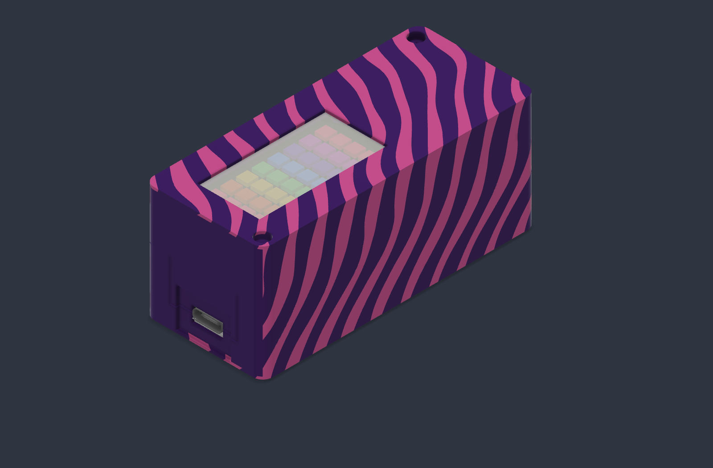

# Echo Glow producer enclosure

This is the **Echo Glow** producer variant with a Reverse TFT Feather, 4×8
NeoPixel FeatherWing, and the modeled 19 × 69 mm cylindrical battery. It is a
separate Fusion lineage from the handheld DidgeLights producer revision 11.

- [Revision 2 direct-USB print bundle](revision-2/README.md)
- [Editable Fusion archive](revision-2/Echo-Glow-producer-direct-USB-r2.f3d)

