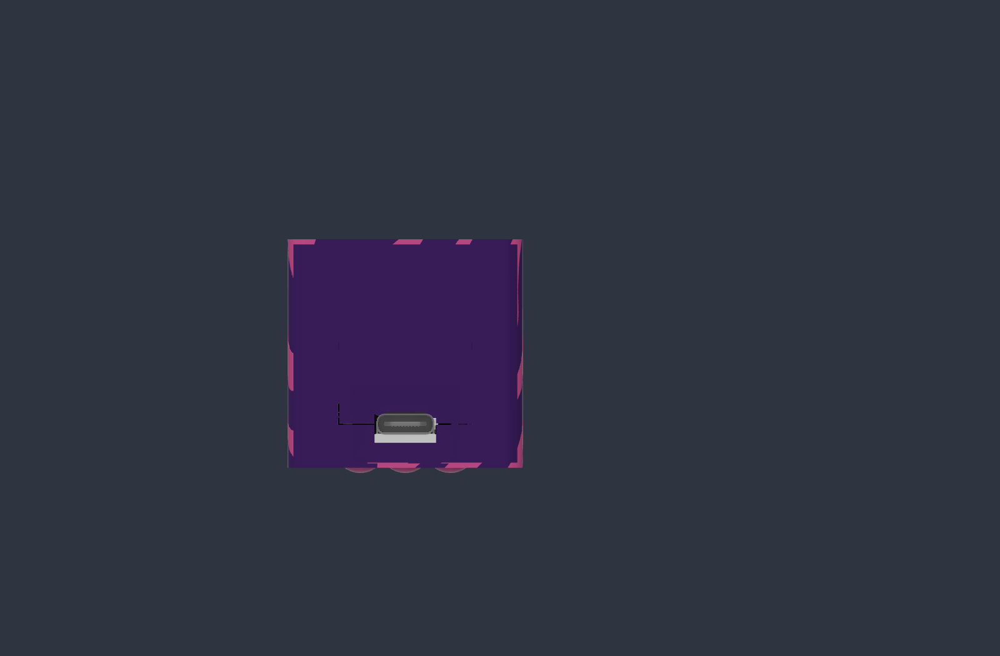

# Echo Glow producer — revision 2 direct USB

The Adafruit ESP32-S3 Reverse TFT Feather's **onboard USB-C** is accessible at
the board end. A local stepped seam crosses the USB mouth so the board can be
lowered into the front half before the rear half closes around the connector.
The separate wired charger port at the battery end is closed. The saved Fusion
document continues the existing **Echo Glow producer v1** lineage. This
revision does not replace the separate
DidgeLights handheld producer revision 11.

## Geometry

| Item | Revision 2 |
| --- | --- |
| Closed shell | 84.3 × 36.46 × 35.4 mm, excluding buttons |
| Board-end outer plane | X = −2.3 mm; USB nose X = −1.213 mm |
| Main seam | Z = 16 mm |
| Local USB seam | Front ends Z = 3.265 mm; rear tab starts Z = 3.465 mm |
| Socket-body relief | 9.54 × 4.8 mm, 0.3 mm around the modeled 8.94 × 4.2 mm body |
| Plug housing recess | 16.94 × 12.2 mm, 1.2 mm deep; 0.8 mm wall at its back |
| Board-end case screw | X = 1.1 mm, Y = −3.3 mm; the far screw remains unchanged |
| Battery end stop | On the closing rear half, ending X = 0.8 mm; nominal 0.2 mm from the modeled cell start |

The local split follows the USB **mouth** center at Z = 3.365 mm. Its lower
mounting anchors make the full connector body's center Z = 2.87 mm. The USB
nose protrudes 0.113 mm into the plug recess while remaining 1.087 mm behind
the outside end plane. The rest of the perimeter seam remains at Z = 16 mm.

The former front battery stop blocked a straight downward board path. It is
suppressed and replaced on the rear half. The old battery-end panel-port feature
is also suppressed in the parametric source. Both plain covers and the rebuilt
pink/purple color-region snapshots are retained in the native archive.

## Print choices

| Files | Quantity / use |
| --- | --- |
| `plain-front-housing.stl`, `plain-rear-cover.stl` | One each for single-color covers |
| `front-patterned.3mf`, `rear-patterned.3mf` | One each for multipart pink/purple covers instead |
| `front-purple.stl` + `front-pink.stl` | Alternate registered color regions for one front cover |
| `rear-purple.stl` + `rear-pink.stl` | Alternate registered color regions for one rear cover |
| `diffuser.stl` | One optional translucent LED-window panel |
| `button-carrier-flat.stl` **or** `button-carrier-domed.stl` | One temporary four-button carrier |
| `button-plunger-flat.stl` **or** `button-plunger-domed.stl` | Alternatively, three separate main buttons |
| `reset-plunger-flush.stl` | One only with separate main buttons |

The five button assets are unchanged, bed-oriented copies from the verified
DidgeLights producer revision 11. One carrier replaces all four separate
plungers. Its frame and links are temporary: use a 0.2 mm first layer, cut the
links flush, remove the entire frame, then install the PCB.

STLs are in millimeters, with each cover's outside face on the bed. Import the
two color-region STLs for a cover **as parts of one object**, without changing
their shared coordinates. Pink islands are color regions, not loose parts.
The 3MF files contain unsliced multipart geometry and color labels. The user
handles Bambu Studio and printing.

## Assembly and checks

1. Fit the chosen button plungers in the front cover, removing the carrier if
   used. Lower the Reverse TFT Feather vertically onto its existing supports
   and locating pegs. Its USB-C passes through the open front notch.
2. Fit the existing Wing and battery arrangement. Keep leads clear of the seam,
   USB opening, fasteners, and the two battery saddles. The rear stop has a
   nominal 0.2 mm gap to the modeled cell end; do not force a real cell against
   it.
3. Add the optional diffuser behind the LED window. Close the rear half so its
   local tab surrounds the upper USB body and the new battery stop approaches
   the cell end. Use the existing two M2 × 20 mm socket-cap screws.
4. Check that a real USB-C plug seats fully, the buttons travel independently,
   the halves close without force, and the battery and leads remain clear.

The Fusion model and meshes passed the checks in [verification.json](verification.json).
The old modeled rear lip still intersects the idealized battery cylinder by
6.82 mm³ near X = 1.0–1.15 mm; the new stop ends at X = 0.8 mm. Actual cell
shape, cable housing fit, insertion feel, and printed seam durability need a
physical prototype. No print-fit result is claimed.

The complete source is [Echo-Glow-producer-direct-USB-r2.f3d](Echo-Glow-producer-direct-USB-r2.f3d).
[bundle-manifest.json](bundle-manifest.json) records release-file hashes. The
pre-edit unsaved Fusion state was archived locally under ignored `backups/`.
